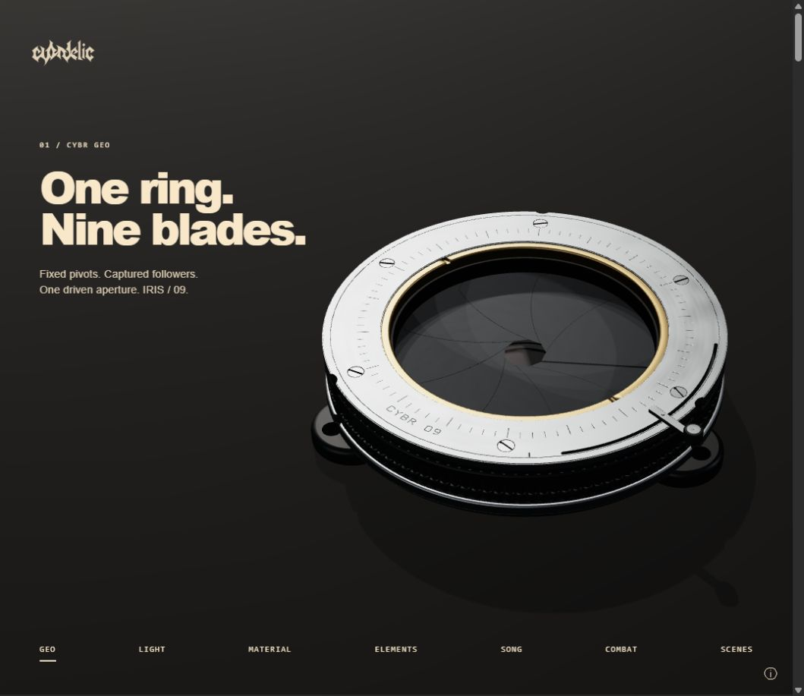
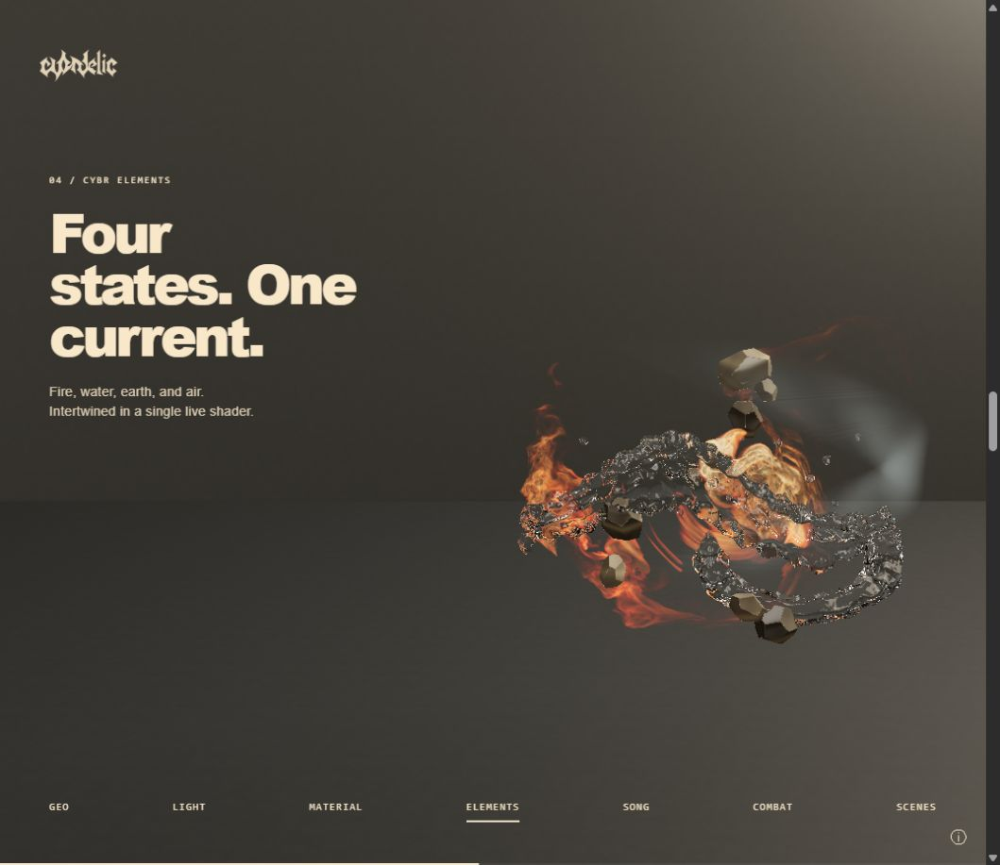
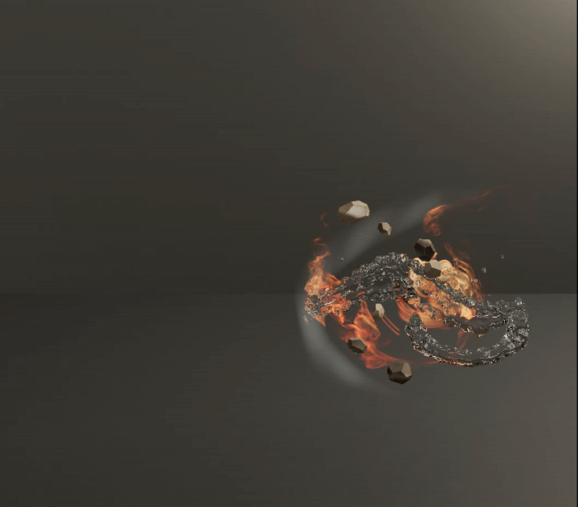

# CYBR portfolio — current development snapshot

A source snapshot of the current CYBRDELIC portfolio, including the IRIS / 09 mechanism and the ELEMENTS volume renderer. The development entry is `portfolio/directions.html?concept=11` (Shadow Choreography). This snapshot contains current work from 20–22 October 2026; it is a review subset, with explicit exclusions below.







These are existing application captures from 22 October, not generated mockups. The GIF is a nine-second, 12 fps conversion of the [original recording](docs/media/elements-native-2026-10-22.mp4). It demonstrates a prior captured state; the snapshot has continued source development and is not certified pixel-identical to that recording.

## Run locally

Requirements: Python 3.10+ for a static server; a desktop browser with WebGL2, floating-point textures, `DecompressionStream`, and secure-context Web Crypto. Node.js 20+ runs the CPU regression tests. Three.js r180 and three-mesh-bvh are bundled with their original MIT licenses; no npm installation is needed.

From the repository checkout root, enter this isolated review snapshot:

```sh
cd snapshots/2026-10-22-current
python -m http.server 4187 --bind 127.0.0.1
```

Open <http://127.0.0.1:4187/portfolio/directions.html?concept=11>. Serve the repository root, because browser imports and selected assets use sibling `cybr-*` directories. Use chapter buttons or scroll. Loading source volumes can take time and consume substantial GPU memory. Keep the server on loopback.

This is a bounded current-source package. It is **not yet a complete standalone release** of every portfolio chapter and archive page. The native SCENES finish requires two excluded third-party rock textures, and the older fluid playback loader still references an unbundled historical mesh cache. Archive detail pages, design boards, other concept variants, and their historical assets are excluded. Missing resources are documented in [scope and blockers](docs/SCOPE.md); they must not be described as validated functionality.

## Architecture

| Path | Responsibility |
| --- | --- |
| `portfolio/directions.html`, `directions.mjs`, `direction-11.css` | Seven-chapter presentation, scene lifecycle and camera/navigation |
| `portfolio/iris09-*` | Source-derived IRIS geometry, single-input constrained mechanism, lighting and optics adapters |
| `portfolio/assets/iris09/IRIS-09.glsl` | Preserved Revision III reference shader; source SHA-256 retained |
| `portfolio/direction11-elements-shader.mjs` | Integrated water, fire, air and fractured forms |
| `portfolio/elements-*.mjs` | Volume decoding, water transport, room/reflection integration and bounded composition |
| `portfolio/assets/elements-current/` | Native fire fields, water SDF and occupancy data |
| `portfolio/journey-projects.mjs` | Lazy loading of scene, score and mannequin chapters |
| `cybr-geo/`, `cybr-light/` | Selected technical drawing and material-map helpers, with existing component licenses |
| `docs/media/` | Reviewed screenshots and recording-derived GIF |

The default IRIS presentation uses raster PBR and bounded optical approximations. The preserved GLSL reference is a separate procedural fragment scene. IRIS constraints are geometric; no dynamics, fatigue or manufacturing certification is implied. ELEMENTS combines precomputed native fields and live shader evaluation; it does not run the native fluid solver in the browser.

## Validation and current status

The staged CPU run exercised 100 existing tests: **97 passed, 3 failed**. All three failures are in the retained `direction11-elements-shader.test.mjs`: the asserted loop inventory, air support-culling expression, and fracture-neighbor count differ from current shader source. The implementation and assertions were preserved; the failures were not hidden by changing them. Other tested volume-data, water-transport, HDR-composition, room-probe, projected-region, recorder and IRIS provenance checks passed.

To reproduce the targeted check:

```sh
node --test portfolio/iris09-source.test.mjs portfolio/direction11-elements-shader.test.mjs portfolio/elements-volume-data.test.mjs portfolio/elements-water-transport.test.mjs portfolio/elements-hdr-composite.test.mjs portfolio/elements-room-probe.test.mjs portfolio/elements-projected-region.test.mjs portfolio/canvas-demo-recorder.test.mjs
```

No fresh full-browser walkthrough, full archive-link test, or GPU performance acceptance was performed on this reduced snapshot. Existing screenshots do not establish those results. See [scope and blockers](docs/SCOPE.md).

## Source and licenses

Live source folders were not modified. Source bytes and staged hashes are recorded in the separately held snapshot audit; publication metadata omits personal absolute paths and chat identifiers. CYBRVOL1 metadata headers were sanitized while keeping compressed field payload bytes and their declared payload hashes unchanged. The IRIS provenance test was adjusted only to require the absence of private conversation metadata.

No new blanket license is assigned. Existing component and asset licenses are retained. See [third-party notices and asset scope](docs/THIRD_PARTY.md). Public distribution must use the reviewed file manifest and preserve these notices; the live workspace and historical output directories are outside the intended payload.
