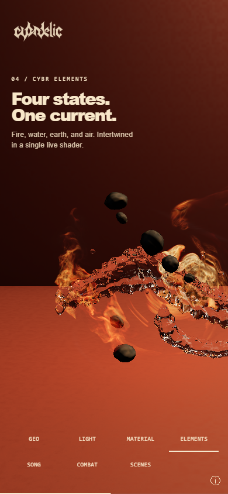
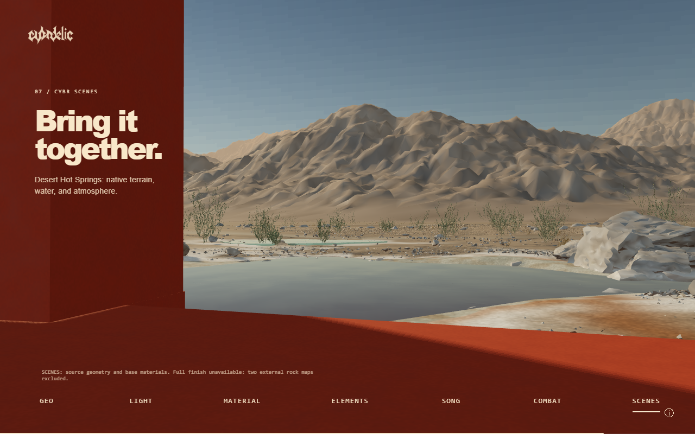
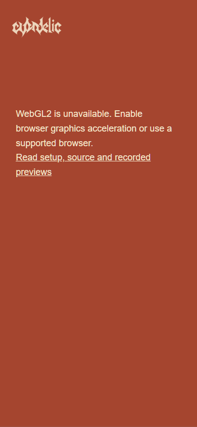

# Portability and fresh-checkout audit

This branch changes the selected snapshot only. It does not change the live portfolio, GEO work, simulation solvers, native volume data, or the recovered reference GLSL.

## Actual baseline defects

A fresh checkout of `1cceab760681f0e3939a8efc13fe414dac1e6490` reproduced 97 passes and 3 failures in the documented 100-test CPU suite. Windows Chrome rendered the opening IRIS geometry, then background chapter compilation reported `clearcoat: no such field in structure PhysicalMaterial`. Two excluded rock maps returned404 and poisoned the shared readiness state. Historical navigation also pointed outside the supplied snapshot.

The floor now guards both custom `material.clearcoat` writes with Three r180's `USE_CLEARCOAT` definition. Zero clearcoat remains zero; this does not enable a cosmetic layer. Both branches have regression coverage, including the compiled-out struct-member contract.

## Why the three shader tests changed

The production ELEMENTS shader is unchanged by these test repairs.

1. **Loop inventory:** `nearbyFireLighting` adds one fixed three-iteration loop, with one native-field texture sample per iteration at a resolved stone surface. The complete exact loop list still checks every loop. A call-graph walk now also rejects direct and indirect recursion; a separate assertion excludes transport traversal inside the lighting helper. The96-event,96-cell,64-volume,4-body,4-TIR and9-refinement bounds remain unchanged.
2. **Air support:** `filteredAirFilament` is a Gaussian with nonzero tails, so the old finite ellipse proof and0.685 cutoff no longer describe it. `atmosphere` multiplies the result by `smoothstep(.55,.72,r)*(1-smoothstep(1.48,1.65,r))`. That factor is exactly zero outside[.55,1.65], for every filter width, phase, footprint and interval. The test extracts the actual expression and skip thresholds, proves squared thresholds fit this support, and checks 4,097 sample radii. It also checks that the authored air expression actually multiplies the factor.
3. **Stone bounds:** `rockPiece` replaced 12 planar faces with `|q|-1 + .045*sin(...)*sin(...) + .023*sin(...)`, followed by three rounded max cuts. Since each sinusoidal term is bounded, the uncut body is inside radius 1.068. Rounded max only removes volume. The perturbation gradient bound is `.045*hypot(3.1,3.7,2.2)+.023*hypot(6.4,4.8,3.6)<.45`, so division by 1.45 remains conservative. Tests check the exact expression, three cuts, gradient bound, all 9 stone sizes including hero enlargement, rotated sphere bound, and y-jitter plus radius below1.5 cell spacings, at both default and native-volume staging scales.

## Included fallback and browser requirements

Concept 11 is the snapshot's default and only supported direction. The full native SCENES finish remains unavailable because two third-party rock maps were deliberately excluded. SCENES shows included source geometry and base materials, with this limitation visible in the page and diagnostics. No replacement texture or licensed asset has been invented. The historical fluid cache and detail/design-board routes remain excluded.

The bootstrap checks WebGL2 context creation, `EXT_color_buffer_float`, `OES_texture_float_linear`, DecompressionStream and WebCrypto before loading the renderer. Unsupported environments get an explicit message and setup/preview link. Localhost or HTTPS is required. These checks do not prove acceptable speed on all graphics devices.

Mobile navigation uses44px controls with a four-column layout; short landscape screens get a smaller caption. Reduced motion is honored. Automated browser checks use desktop Chrome and mobile-sized desktop viewports, not physical iOS/Android hardware.

## Reproduce

From this snapshot directory on Windows, Linux or macOS, install Node 22, then:

```text
npm ci
npm test
npm run serve
```

Open `http://127.0.0.1:4187/portfolio/directions.html`. The app is static and needs no bundle/build step. The original Python static-server instructions also remain valid. Node and npm are only required for the optional test harness/server.

```text
npx playwright install chromium
npm run test:browser
```

Linux CI uses `npx playwright install --with-deps chromium`. The repository-root workflow tests Node contracts and production static-browser behavior on Windows, Ubuntu and macOS. Hosted workflow results must be checked separately; adding a workflow does not prove it has passed.

Browser checks save machine-readable results and real screenshots to ignored `evidence/browser/`. The walkthrough covers seven chapters at desktop and mobile viewport sizes, resource/console errors, navigation bounds and four missing-capability paths. This is bounded browser coverage, not validation of the original full films, device-wide performance or every historical project.

## Observed results, 22 October 2026

Windows Node 22: fresh `npm ci` passed (2 packages, 0 audit vulnerabilities); the expanded CPU suite passed 118/118. Independent review also passed 31/31 shader and integration tests.

Chrome 145.0.7632.160 with the CI SwiftShader configuration passed all 18 browser checks in 232.491 seconds: all seven chapters at 1280×800 and 390×844, plus missing WebGL2, DecompressionStream, WebCrypto and float-render-target paths. No network/console errors were accepted. The desktop ELEMENTS transition took 47.183 seconds and SCENES 32.222 seconds. This is functional evidence, not a responsiveness/performance target.

An earlier hardware-default run exceeded its 120-second ELEMENTS preparation deadline. Diagnostics after the timeout showed loaded fields, ready=true and no rendering errors; that attempt remains a failed timing check. The smoke allows a documented 180-second cold-preparation budget. No further budget increases were used. The page keeps ready=false and “Preparing GPU materials” while its exact visible program is pending.





The captures above are from the final Windows browser run. The source volume data and rendering algorithms were not reduced to make the smoke pass. Hardware acceleration, physical phones and other browser engines remain separate qualification work.

The capability fallback decoration was then corrected after pixel review; a focused four-case rerun passed in 7.735 seconds without repeating the full walkthrough.


